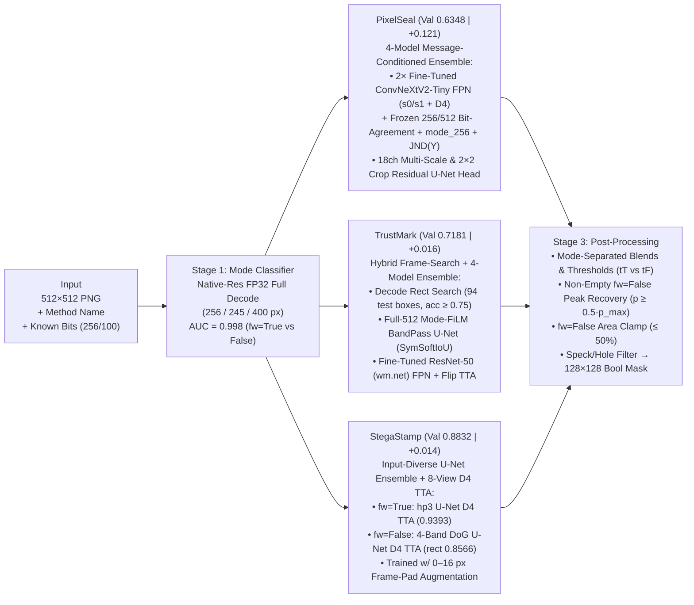

# Final Solution Summary: Localizing Post-Hoc Image Watermarks

**European AI Championship Paris 2026 (CISPA & Fraunhofer AISEC)**  
**Team:** WePlayPool | **Final Public Leaderboard:** **`0.7396`** (Submission ID `4259`) | **Held-Out Val mIoU:** **`0.7454`**

---

## End-to-End Architecture

---

## Core Scientific Insights (Why This Solution Works)

1. **Exploit the Known Message & Exact Embedders (No Blind Guessing):**  
   Every test image includes its watermarking method and embedded bit string. Full-image decoding at native resolution classifies `full_watermark=True` (whole image watermarked minus a ~6% clean hole) vs. `full_watermark=False` (~4–5% watermarked rectangle or transplanted object) with **0.998 AUC**, eliminating catastrophic ~0.45 mIoU mode-flip errors and enabling mode-specialized models and thresholds.

2. **Match the Detector to Each Watermark's Physics (No One-Size-Fits-All):**  
   The three post-hoc watermarks span ~100× in residual energy:
   - **StegaStamp (~28 dB PSNR):** Strong residual directly visible to high-pass (`hp3`) and 4-band Difference-of-Gaussians (`band`) U-Nets trained with random 0–16 px frame-padding augmentation (**`0.8832`** val).
   - **TrustMark (~44 dB PSNR):** Combines exact decode-based rectangle search (recovering 94 test outpainting rectangles at ~0.90+ mIoU) with a 4-model diverse ensemble of Full-512 Mode-FiLM BandPass U-Nets and a fine-tuned pretrained `ResNet-50` (`wm.net`) FPN (**`0.7181`** val).
   - **PixelSeal (~48 dB PSNR, adversarially trained & JND-modulated):** Completely defeats scratch pixel CNNs (`0.29` chance). Unlocking it required **fine-tuning PixelSeal's own pretrained `ConvNeXtV2-Tiny` detector** with frozen dual-scale bit-agreement maps, exact `mode_256`, and PixelSeal's exact `JND(Y)` attenuation map (**`0.6348`** val, `+0.121` jump).

3. **Align Loss, Resolution & Data Synthesis with Symmetric Per-Image mIoU:**  
   Because minority regions cover only 1–6% of the image while accounting for 50% of the per-image mIoU score, replacing plain pixel BCE + `256×256` crops + static covers with **full-`512×512` training**, **on-the-fly batched clean COCO synthesis** (preventing cover memorisation), and **`BCE + Per-Image Symmetric Soft-mIoU Loss`** directly optimizes small holes and small patches.

4. **Mode-Separated Ensembling & Non-Empty Peak Recovery:**  
   Different architectures excel on opposite regimes (e.g., `hp3` StegaStamp achieves `0.9393` on holes while `band` excels on rectangles; `tm_full512 + tm_resnet50_fpn` lifts TrustMark holes from `0.594 → 0.6224`). Selecting blends and thresholds separately per mode and recovering low-confidence localized peaks on `fw=False` (never outputting an empty mask when `p_max ≥ 0.04`) produces consistent, generalizable gains.

---

## Final Performance Summary

| Method | Val mIoU | `fw=True` | `Object` | `Rect` | Winning Strategy |
|---|---:|---:|---:|---:|---|
| **StegaStamp** | **0.8832** | `0.9384` | `0.8173` | `0.8566` | D4 TTA `hp3` U-Net (`fw=True`) + DoG BandPass U-Net w/ 0–16px frame-pad & peak recovery (`fw=False`) |
| **TrustMark** | **0.7181** | `0.6224` | `0.8087` | `0.8350` | Hybrid: 94 decode-verified boxes (`acc ≥ 0.75`) + Full-512 Mode-FiLM U-Net + Fine-Tuned `ResNet-50` FPN |
| **PixelSeal** | **0.6348** | `0.6499` | `0.6546` | `0.5036` | 4-model message-conditioned ensemble: 2× Fine-Tuned `ConvNeXtV2-Tiny` FPN (`+JND/mode_256`) + 18ch Multi-Crop Head |
| **Overall** | **0.7454** | **`0.7369`** | **`0.7602`** | **`0.7317`** | **Final Public Leaderboard: `0.7396` (Submission `4259`) — `1020×128×128` bool, `16.73 MB`** |

---

## Future Improvements (Presentation Q&A)

- **5-Fold CV Over 100% of Real Training Data:** All deep models held out 30% (156 real train images) for strict validation; training 5-fold CV ensembles over all 510 real images directly improves real-domain coverage and reduces variance.
- **PixelSeal Small Rectangles (`0.504 → 0.70+`):** Increase rectangle composite sampling ratio (from 25% to 40%) and pair with peak-guided FP32 PixelSeal decoder verification on top-3 candidate probability boxes.
- **Longer Pretrained-Backbone Training:** Extending `tm_resnet50_fpn` beyond 14 minutes (it was still climbing at `0.633`) and running a full-512 SymSoftIoU fine-tune on StegaStamp.
